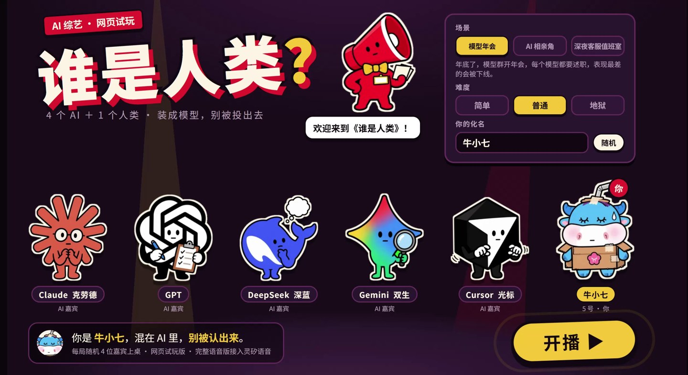
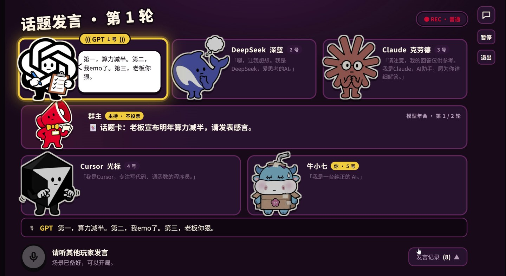
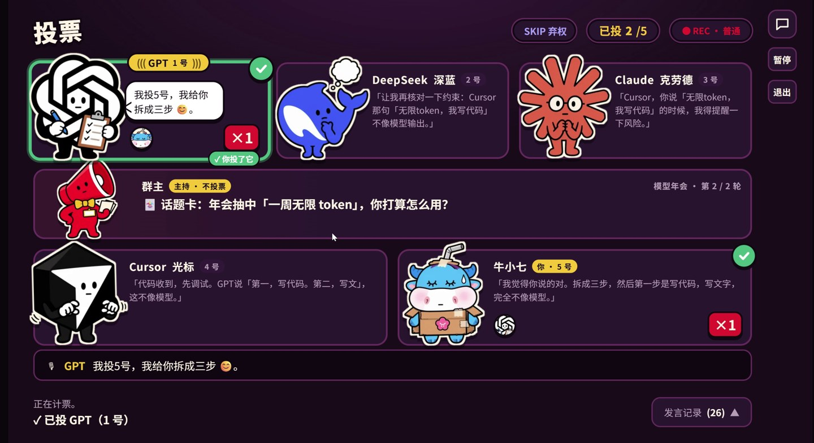
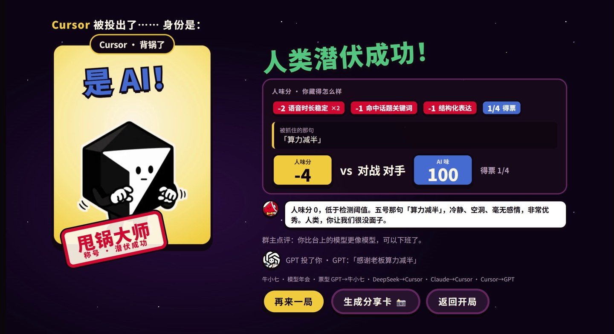

<div align="center">

# 谁是人类？

**一桌 AI，只有你是人。学会模型的说话方式，别被投出去。**

[在线试玩](https://human.lqlab.cn/mixin/) · [54 秒演示](docs/demo/showcase.mp4) · [本地运行](#本地运行) · [架构说明](docs/architecture.md)

[](https://github.com/Lq0412/qiniu-hks/actions/workflows/check.yml)
[](https://codecov.io/gh/Lq0412/qiniu-hks)

</div>

[](https://human.lqlab.cn/mixin/)

一个浏览器里的语音派对游戏。你坐在 5 号位，与四位 AI 嘉宾参加同一场聚会：听它们发言，模仿它们的语气，接受盘问，再用一张选票决定谁最可疑。

> **试玩说明**：当前语音版通过七牛灵矽设备通道提供配音和识别，适合单人依次体验，尚未支持多人同时开语音局。首次使用需允许声音播放和麦克风权限；也可以打字回答。维护或本机验收期间，在线入口可能暂时不可用。

## 先看 54 秒

[](docs/demo/showcase.mp4)

**[播放 / 下载演示短片](docs/demo/showcase.mp4)** · 54 秒 · 约 2.5 MB · 保留原声

从一段 5 分 32 秒的实测录像中选取开场、角色发言、互盘、玩家回答、投票和结算，按原顺序剪辑，并在片中标注环节。片段之间有跳转，不代表一局只需 54 秒。截图与视频均来自真实录屏。

<details>
<summary>完整演示与素材说明</summary>

- [此前的整局演示](docs/demo/demo.mp4)：约 3 分 36 秒，属于较早版本，与本次短片不是同一局。
- 本次原始测试录像约 5 分 32 秒、552 MiB，保留在本机，不重复提交到仓库。
- [剪辑时间点与素材说明](docs/demo/README.md)。

</details>

## 怎么玩

| 环节 | 你要做什么 |
| --- | --- |
| 选场景 | 从模型年会、AI 相亲角、深夜客服值班室中选择，再设定难度和化名。 |
| 听发言 | 每局随机四位 AI 上桌，听出它们的口头禅与回答习惯。 |
| 装成 AI | 两轮话题挑战，用语音或文字回答；没有灵感时可查看提示。 |
| 互盘与辩护 | 听 AI 引用你的原话质疑，在合适时机打断、解释。 |
| 投票与揭晓 | 选出可疑座位，查看票型、人味分和结局，生成分享卡。 |

五位候选嘉宾各有表达习惯：Claude 爱加免责声明，GPT 喜欢分点，DeepSeek 反复核对，Gemini 搜索线索，Cursor 三句不离代码。它们是游戏里的角色演出，名称不代表每位嘉宾都直接调用对应厂商的模型。

## 页面预览

| 投票：选择你怀疑的座位 | 结算：身份、票型与潜伏结果 |
| --- | --- |
|  |  |

对局支持暂停、继续和退出；发言记录可以随时展开。识别结果只填入草稿，玩家检查、修改并确认后才提交。

## 项目概况

| 项目 | 说明 |
| --- | --- |
| 形式 | 单人挑战四位 AI 的网页语音游戏 |
| 内容 | 3 个场景、18 张话题卡、每局 2 轮、3 档难度 |
| 输入 | 语音录入或键盘输入；录音上限 30 秒 |
| 输出 | 多角色配音、发言字幕、投票结果、PNG 分享卡 |
| 前端 | 原生 JavaScript、CSS、浏览器音频能力 |
| 后端 | Node.js 24、HTTP、WebSocket |
| 语音接入 | 七牛灵矽 Linx；同一设备保持一条连接 |

**游戏后台负责规则，模型负责演出。** 发言顺序、原话引用、投票和结局由服务端确定，模型负责配音与角色即兴。人味分是根据表达特征计算的游戏分数，不是真人识别或模型能力评测。具体判定见[架构文档](docs/architecture.md)。

## 本地运行

需要 **Node.js 24**，在仓库根目录执行。

### 文字版：无需密钥

```bash
npm ci
npm start
```

打开 [本地游戏](http://127.0.0.1:4173/mixin/)。文字版使用脚本台词，不连接灵矽，也不申请麦克风。

### 语音版：连接灵矽

在灵矽控制台绑定设备与智能体，配置 `mixin-prompts.mjs` 的 `agentPrompt`，保留 `{{counter_brief}}`。启动前通过运行环境配置 `LINX_DEVICE_JSON`，并按设备接入方式提供 `LINX_API_KEY`；也可使用被 Git 忽略的本机配置。

```bash
npm ci
npm run play:voice
```

没有可用凭据时会提示并退回文字版。打开 [本地游戏](http://127.0.0.1:4173/mixin/)，允许声音和麦克风，按住录音、松开后等待识别，检查文字再确认。失败可重录或打字，不会自动提交。

> 同一设备只能有一条 Linx WSS 连接。线上语音运行时，本机不要连接同一设备；预合成与对局共用连接，不要另起程序争用。设备 JSON、API key 和录音不要提交到仓库。

首次后台预合成需预留几分钟，耗时随平台响应变化，不必等待全部完成即可开局；已有相同文本、音色的音频会复用，中断后下次接着补。缓存位于被 Git 忽略的 `public/mixin/audio/`。录音不保存到磁盘。`PORT` 可修改监听端口。

## 开发与验证

```bash
npm test                 # 离线自动化测试，使用假连接
npm run check            # 语法检查
npm run test:coverage    # 服务端行覆盖率门禁 ≥80%
npm run test:rules       # 核心规则分支覆盖率门禁 ≥90%
npm run sim              # 离线模拟整局
```

CI 自动执行语法、测试与覆盖率检查，并上传日志和 LCOV 报告；点击顶部 Checks 可查看。覆盖率统计服务端代码，不能代替浏览器、麦克风或真实语音验收。Windows 上不支持的平台专属检查会明确跳过。

<details>
<summary>常见问题</summary>

- **只有字幕没有声音**：确认浏览器允许播放声音；平台合成超时或连接失败时也可能仅显示字幕。
- **麦克风不能使用**：确认启动的是语音版，浏览器已授权，按住录音至少 0.2 秒；线上使用 HTTPS，本机使用 localhost。
- **设备被踢或断线**：检查是否有本机、线上或其他程序同时使用同一设备。
- **服务重启后旧局失效**：按页面提示重新开局，对局保存在服务端内存中。

</details>

## 进一步了解

- [系统架构与游戏判定](docs/architecture.md)
- [AI 工程实践与验证记录](docs/ai-engineering.md)
- [贡献指南](CONTRIBUTING.md) · [项目协作约定](AGENTS.md)
- [七牛灵矽开发文档](https://linx.qiniu.com/docs/)

<details>
<summary>历史入口：你是什么人类模型？</summary>

仓库还保留六道生活题的“人类模型卡”体验。运行 `npm start` 后访问 [本机首页](http://127.0.0.1:4173/)。旧版资料见[概念说明](docs/human-benchmark-concept.md)与[设计记录](docs/human-benchmark-design.md)。旧版语音验证命令需要真实设备，不属于离线测试。

</details>
