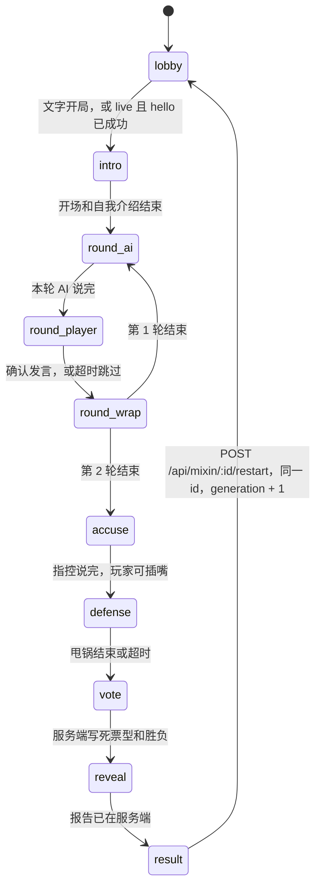

# 谁是人类 · 架构

这一步交付服务端纯逻辑和文字模式。旧版「你是什么人类模型？」仍是 `npm start` 的默认真玩入口。新对局不打开灵矽、不申请麦克风。语音调度的约束按 [ADR-005 #14](https://github.com/Lq0412/qiniu-hks/issues/14) 的真机探针写在下面；换音色、预合成和连接改写留给后面的语音调度 PR，本步不实现。

## 模块

| 模块 | 职责 |
| --- | --- |
| `mixin-game.mjs` | 对局状态机。身份、票型和胜负只在这里落账。露出 `stage`（与 `phase` 相同）和 `generation`。`enter` 失败会回滚；需要台词却没有台词时停在 `error`，避免空转。 |
| `humanity.mjs` | 确定性人味分、难度票型、`judgeOutcome`。同样的输入得到同样的票。匹配前先做转写归一化。 |
| `mixin-roles.mjs` | 虚构角色、关系梗、代号池、发牌。每个角色有 `voice`（描述和 `rate`），`voiceId` 来自音色表。 |
| `mixin-bank.mjs` | 三个场景、18 张话题卡、指控提示。卡上的回复不超过 40 字。 |
| `mixin-prompts.mjs` | `agentPrompt`（占位符是 `{{counter_brief}}`，与控制台提示一致）、开场白、`renderBrief`、舞台指令。纯函数，不假设平台怎么投递。 |
| `mixin-voice.mjs` | 座位发言接口，以及按角色 id 索引的音色表。默认 8 秒超时，超时、抛错或空字符串都改用 `fallbackText`。 |
| `mixin-endings.mjs` | 揭晓口播。按胜负从定稿模板抽一条，填人味分、投票者和玩家原话。不调用模型。 |
| `mixin-session.mjs` | 文字会话。`playScript` / `runUntilResult` 跑完整局。`restart` 只在结局阶段重开。 |
| `mixin-http.mjs` | `/api/mixin`。和旧的 `/api/game`、`/voice` 分开，cookie 用 `mixin`。 |
| `scripts/sim-mixin.mjs` | `npm run sim`。打印阶段、票型和结局字段。 |

`server.mjs` 只多挂了文字入口：请求体上限 4096 字节，`/api/mixin/:id` 要求 cookie `mixin` 与路径里的 id 相同。`linx.mjs`、`game.mjs`、`scoring.mjs`、`benchmark.mjs` 和 `public/` 这一步不改行为。

## 数据流

文字局由客户端调用推进。服务端没有自己的挂钟；到点不会自己往下走。`tick` 和 `step` 都是客户端打进来的。真语音改成服务端挂钟，留到语音调度。

```text
npm run sim 或 POST /api/mixin
  → createTextSession
  → createMixinGame（校验发牌、代号，代数号 1）
  → 客户端 POST .../start，再按阶段 POST .../step 或 .../tick
  → 每个 AI / 主持人回合：dispatchSeatSpeech → fulfillCue
  → 玩家回合：submitPlayerText → confirmPlayer（保留修订号）
  → 投票阶段 ensurePlan
       humanity.planVotes 算出四张 AI 票
       humanity.judgeOutcome 判胜负和甩锅大师
  → reveal 时服务端先写报告，再让主持人念
  → applyReportCopy 只能改文案；票数、胜负、aiScore 改不了
  → 结局后 POST .../restart：同一 id，generation + 1，回到 lobby
```

以后的真语音局是一条灵矽连接打完整局：hello 时注入一次 `{{counter_brief}}`，之后每个回合用 `listen.detect` 换座位和音色，不按阶段重连，也不重新 OTA。这一步不实现这条连接。旧连接带着过期的 `generation` 来写局面时，状态机会拒绝。

## 状态机

玩家固定坐 5 号。两轮都是 AI 先说、玩家最后。演示局（`demo: true`）锁定普通难度、场景「模型年会」、话题卡 A2 再 A1、阵容柯老师 / 阿斯哥 / 深思哥 / 包包、代号「碳基-7B」。演示局里如果调用方仍然传了 `cardIds`、`roleIds` 或 `alias`，会先校验，不合法直接拒绝，不会静默换成演示牌。第 2 轮只留轮转后的前两名 AI。



任意阶段断开都会进入 `error`，`stage` 一起变成 `error`。重连回到断开前的阶段，刷新截止时间，不增加 `generation`。只有重开才会加一代。重开只接受结局阶段。

`enter` 先记下当前阶段。抛错时先恢复，再抛出。如果恢复之后这一阶段本来该有台词却没有（`intro`、`round_ai`、`round_wrap`、`accuse`、`reveal`），局面改停在 `error`，`tick` 不会空转。大厅里发牌失败仍留在 `lobby` 并抛错，不会建出一局冻住的会话。

## 建局白名单

HTTP 建局只接受 `demo`、`difficulty`、`seed`、`sceneId`、`cardIds`、`roleIds`、`alias`。多出来的字段返回 409，不建会话。`seed` 必须是整数。`difficulty` 必须是 `easy` / `normal` / `hell`；演示局仍会把难度收成普通。`roleIds` 必须是 4 个互不相同、可以上桌的 AI（柯老师、阿斯哥、深思哥、包包、小四），不能是群主或玩家。`cardIds` 必须是当前场景里的两张不同卡；没传 `sceneId` 且不是演示局时，两张卡同属一个场景才会推断场景。`alias` 要么在代号池里，要么洗成不超过 12 个汉字、拉丁字母、数字或连字符；洗完是空的就拒绝。`debug` 只在 `createMixinGame` 里打开，不在 HTTP 白名单里。

请求体超过 4096 字节返回 400。路径里的局 id 必须等于 cookie `mixin`，否则 409。会话超过 1 小时未更新会被清掉。`tick` 的 `now` 必须是不小于当前时刻的整数，`ms` 必须是 0 到 120000 的整数；时间不能倒退。

## 公开视图

揭晓（`reveal` / `result`）之前：

- `humanScore` 和 `aiScore` 是 `null`。
- `script` 是空数组。
- `votes` 只包含已经念出来的那几张票和对应计票。还没人报票时是 `null`。完整票型（含是否投给玩家）只在揭晓或 `debug` 时给出。
- 报票回合的公开舞台指令不写「我投 N 号」，只说请宣布投票。念完之后，这张票才出现在 `votes` 里。
- `trace` 只有 `phase` 和 `at`。
- 简报的局势写「身份和票型由系统固定，揭晓前不要猜测谁是人类」，不写胜负。
- `cue` 去掉 `fallbackText`。

`debug: true` 时分数和剧本提前可见。HTTP 建局传不了这个开关。

## 人味分

计分在 `humanity.mjs`，风格对齐旧的 `scoring.mjs`：多特征、词边界、容错区间，结果确定。不用「一看到某个字就加分」的松散规则。匹配前先 `normalizeForMatch`：全角折叠成半角；带分钟的时刻（`7:30`、`七点半`、`七点三十`、`七点三十分`、`7点30分`）收成 `H:MM`。点后面单独一个中文数字、后面不跟「分」，按十分钟计，所以「七点三」是 7:30，「三点五」是 3:50。「零」或「〇」再加一位数字仍是精确分钟，「七点零三」是 7:03。后面有「分」也是精确分钟，「十二点五分」仍是 12:05。阿拉伯数字不乘十。单独的「两」「二」收成 `2`。不改裸的「N点」（所以「有一点」不动），不改「十二」「二十」「第二」。小时大于 23 或分钟大于 59 保持原样。前一个字已经是数字时不再起一个时刻，所以「99点半」不会被看成「9:30」。标点只折叠、不删掉，所以「我，妈」不会变成「我妈」。

- 生活说法要整词，例如「我昨天」「我妈」。单独的「饿」「困」不加分，所以「饥饿」「困难」不会被误判。「我妈」后面是「的」不算生活说法，「我妈的手机」不加这一分。
- 脏话和身份词有前后排除字。「他妈」后面是「妈」不算（挡住「他妈妈」「其他妈妈」）。「妈的」前面是「我爸奶妈姑姨舅婶干后继岳」不算（挡住「我妈的手机」）。「我是人类」后面是「学」不算，「我是人类学家」不加身份分。「我是真人」后面是「秀」、「我就是人」后面是「才工员家民生道性事群口」同样排除，所以「我就是人才」不加分。「我就是人类」算身份暴露。
- 数字和拉丁词有边界。「18点」不命中「8点」，「EMAIL」不命中「AI」。「晚上8点见」仍命中「8点」。
- 语气词要凑够两个才加 1 分。「也就是」里的「就是」不算。「哈哈」只算笑声，不再同时算语气词。
- 身份暴露或脏话加 3 分，不再叠加情绪分。
- 停顿看标记：跳过 +2，主动要提示 +1。8 秒自动展开的示例只把 `hintReleased` 设为真，不记 `usedHint`。只有玩家自己调用提示才记 `hintTaken`。每一轮开始时 `hintTaken` 清回 false，上一轮要过提示不会带到下一轮。没有标记时，沉默要超过 12.5 秒或 20.5 秒才加分，留 500 毫秒余量。
- 时长惩罚只在非打字、且时长落在 4.25 秒到 11.75 秒之间。文字模式默认 `typed: true`，不吃这条。
- 冷静复述要在辩护阶段、没有情绪词，并且和别人的原话有至少 6 个有效字重合。
- AI 腔（「作为一个语言模型」「首先…其次」「希望对你有帮助」等）、结构化分点、免责声明、命中话题卡关键词，分别扣分。AI 腔合计最多扣 3 分。

`aiScore = clamp(100 - 人味分 × 10, 0, 100)`。

## 胜负与计票（ADR-007）

`humanity.mjs` 计算票型和胜负。`mixin-game.mjs` 的 `ensurePlan` 把结果写进对局。模型只能念，不能改。

- 被识破：5 号拿到的 AI 票 ≥2，并且是最高票。并列最高也算被识破。否则潜伏成功。1 票即使并列最高，也不算被识破。
- 结局上的 `x/4` 只数这 4 张 AI 票。玩家自己投给谁，不进入这 4 票。
- 简单档：人味分 ≥5 给 2 票，3–4 分给 1 票，低于 3 分给 0 票。
- 普通档：识破给 3 票，否则 1 票。阈值是人味分 ≥3。
- 地狱档：识破给 4 票，否则 0 票。阈值是人味分 ≥1。
- 甩锅大师只在潜伏成功，并且玩家投中的座位是 AI 票里严格第二高。0 票不算第二。弃权不算。已经被识破时，即使投中第二也不算。并列第二的座位都算。

票怎么分到座位上：优先把票堆给替罪羊以外的低号位，替罪羊再投自己的关系对手；对手不在桌上就投另一个不是自己的座位。没有人投自己。

## 超时与兜底

每个等待都有截止时间，但这一步要等客户端调用 `tick` 或 `step` 才会推进。真语音再改成服务端挂钟。AI 或主持人没说出字、抛错，或超过 8 秒，就用该回合的 `fallbackText`，并在跳过时补一句「N号模型正在深度思考，先跳过。」玩家 15 秒是界面文案，20 秒才是硬跳过。空转写先给一次重说。揭晓阶段一开始就把报告写好，主持人念失败也不影响结算。

## 回声

开场白和舞台指令可能被语音识别原样送回来。回合开始时记下舞台指令和兜底台词，发言落地后再记下说出的字。`isStageEcho` 去掉空白和标点、忽略大小写后比对：完全一致，或两边都不短于 12 字且重叠达到较长一侧的 72%，就丢掉。含「舞台指令」、`counter_brief` 或旧字段名 `game_brief` 的也丢掉。调用方可以挂 `isStageEcho(text, game)`：返回 true 强制当回声，false 放行，不返回则走默认规则。经 `listen.detect` 注入的文字也会被识别成玩家语音，语音调度要把这段原文交给同一套过滤。更细的回声边界留到语音调度，不在这一步加特例。

## 语音调度（#14，本步只记约束）

真机探针的结论记在这里，实现留给语音调度 PR。本模块不打开第二条连接，也不合成音频。

- 同一台设备只保持一条 WebSocket。第二条会被断开。
- 每个回合在 `listen.detect` 上用 `agent_params.voice` 换音色。
- 服务端把当前局势写进每一次 detect 的文本。`custom_replace_prompt` 只在 hello 设置一次。占位符是 `{{counter_brief}}`，必须和控制台提示词一致。
- 不依赖 MCP。控制台提示要求模型不调工具。揭晓口播由 `mixin-endings.mjs` 生成，不走 `self.game.report`。
- detect 文本的约定：必须逐字念的内容用「【台词】」包起来，包括群主的固定台词、指控里的原话、报票。只给角色和话题时，模型最多用角色口吻说两句。
- 经 detect 注入的文字会以语音识别结果回来，必须滤掉。
- AI 回合开始的 p90 大约 1.85 秒。前端用「思考」音效和字幕盖住。每局先走一个热身回合。
- 群主音色的首音要 3.0–3.5 秒，所以群主的固定台词（开场、规则、串场）都要预合成，作为开口前的退路。这一步只记下这件事，不生成音频。
- 灵矽服务端有 TTS 缓存：同一句话用同一音色，第二次合成的音频与第一次完全一致。缓存怎么用，留给语音调度。
- 音色 ID 写在 `mixin-voice.mjs`，按角色 id 索引，全部是字符串（纯数字 ID 不能转成数字）。群主·零号用典型播音女 `4bdb867c07d54e119950b5bda44673a7`，一局里固定不换。柯老师用温暖治愈女 `8fca6d5172fc4c309c2d16352ca8a9b3`，备选积极知性女 `b30165086267413f96643a803aed599f`。阿斯哥用沉稳质感男 `2e7965636b0d4472ae51e75f419dff41`。深思哥用深夜播客 `b38d4a6eb8f64c209fa6febfd7f91663`，没有备选。包包用调皮公主 `1965294143278125057`，备选活泼女孩 2.0 `2077603629237219330`。小四用稚气呆板女 `91ccc0758b22473693dfa86c8e7e3fa3`。备选只记在表里，本步失败时不自动换。
- 对局里的音色覆盖用环境变量 `MIXIN_VOICE_IDS`。格式是 `角色id=音色id`，多项用英文逗号分隔，例如 `claudia=8fca6d5172fc4c309c2d16352ca8a9b3,baobao=1965294143278125057`。等号两侧可以有空格。值按字符串读取。缺等号或空 id 的项忽略，没写到的角色继续用表里的默认 id。
- 语音探针用另一个变量 `LINX_VOICE_IDS`。那是按位置排列的音色 id，英文逗号分隔，顺序见探针脚本。探针不会读 `MIXIN_VOICE_IDS`，对局也不会读 `LINX_VOICE_IDS`。

当前指控仍是舞台指令要求模型引用原话，兜底台词是服务端模板，落地时记下实际说出的字，报告文案另做逐字核对。语音调度应改成服务端先套好已经包含原话的「【台词】」再送 detect，这样引用必然逐字。本步不改这条路径。

## 结局口播（ADR-008）

[ADR-008 #19](https://github.com/Lq0412/qiniu-hks/issues/19) 规定揭晓口播由服务端生成。`beginReveal` 调用 `mixin-endings.mjs`，把填好的文本放进揭晓 cue，舞台指令是「【台词】」加上这段口播，兜底台词也是这段口播。模型只照念。不走 LLM，也不走 MCP。

- 被识破从 C1–C5 里抽 1 条。潜伏成功且五号 0 票时只从 S1、S3、S4 里抽。有票时 S1–S5 都可以。随机数可以注入。同一会话最近 3 局尽量不重复；三条候选都被用过时才允许重复。重开会带上这份记录。
- `{玩家原话}`：被识破取最暴露人类的一句（leakQuote），潜伏成功取最像 AI 的一句（bestAiQuote）。先按人味分规则选句，再截到不超过 14 字。被识破时超长原话取包含命中片段的一截，优先在标点处断开，所以「我昨天加班到很晚」不会只剩「我昨天」。潜伏成功仍取最像 AI 的短片段。模板里已经有引号。玩家原话含脏话时整句换成「（已和谐）」，词表和词边界都用 `humanity.mjs`，所以「其他妈妈」不会被误伤。全程没说话时填「……」。原话里的半角、全角花括号先去掉，所以玩家说「{好}」不会把占位符检查卡住。
- `{人味分}` 填不小于 0 的整数，负数口播成 0。`{投票者}`：1 人写名字，2 人用「和」连接；3–4 人时 C2 写「全桌」，C3 写「三位同事」或「四位同事」，其余条目写「全桌」。被识破时投票者一定有值。先填这两处，最后才写入玩家原话，避免原话里的「{人味分}」被再替换一次。
- 花括号检查只针对模板本身：去掉 `{玩家原话}`、`{人味分}`、`{投票者}` 之后不能再有花括号。填完的口播不再做这次检查。生成若抛错，记一条日志，改念「揭晓完毕。五号的胜负和人味分以系统记录为准。」对局照常揭晓，这次不写入结局编号。
- 分享卡称号仍按称号池选取，和口播文本互不影响。
- 揭晓前公开视图里没有口播。`report` 在揭晓前是 null，口播只在进入揭晓、写好 cue 之后出现。

## 玩家代号

代号是内容选择，不是架构决策。演示局锁定「碳基-7B」。其它局从「碳基-7B / 打工人-Turbo / 摸鱼-mini / 熬夜-Pro」里抽。没传种子时种子是 1，抽签可复现。调用方也可以直接指定 `alias`，规则见上面的白名单。

## 怎么跑

```bash
npm run sim
npm run sim -- --stealth
npm run sim -- --difficulty hell --seed 3
```

默认是演示局，难度锁在普通，代号是「碳基-7B」。`--stealth` 或传入 `--difficulty` 都会关掉演示锁，改用固定的年会阵容（A2、A1，柯老师 / 阿斯哥 / 深思哥 / 包包），这样难度参数才会生效。`--stealth` 另用一套低人味台词，用来看潜伏成功。三条都不连灵矽，也不要麦克风。

## 分工

参赛者是 lqlq，一个人参赛，由一支 AI 小队协助。队长 Pema 负责协调。小策设计玩法。小码分发开发并做审查。小演负责路演。云端编程助手负责实现。

## AI 协作方式

架构决定写在 ADR issue 里。一个任务对应一个分支、一个 PR。先开 Draft，再以小步提交推进。审查者只读审查，列出必须修改的项，实现侧按清单改完再交下一轮。真机探针和云端离线测试分开跑，探针结论写回架构，不把未测过的平台行为写进代码。本 PR（[#16](https://github.com/Lq0412/qiniu-hks/pull/16)）就是按这个方式做的：先交文字模式，审查列出词边界、建局白名单和视图泄露，探针 #14 的结论再补进同一条分支。

## 决策记录

- [ADR-001 #10](https://github.com/Lq0412/qiniu-hks/issues/10)：方向定为「谁是人类」，玩家假装是 5 号，旧版留作可玩兜底。
- [ADR-002 #11](https://github.com/Lq0412/qiniu-hks/issues/11)：`main` 保持旧游戏可玩，新玩法在 `feat/mixin-core`，语音探针在 `feat/voice-probe`，界面以后另开分支，改动都走 PR。
- [ADR-003 #12](https://github.com/Lq0412/qiniu-hks/issues/12)：正式玩法是网页按住说话；文字模式不调用 `getUserMedia`，也能打完一局。
- [ADR-004 #13](https://github.com/Lq0412/qiniu-hks/issues/13)：服务端状态机露出阶段和代数号，人味分加难度决定票，每阶段都有超时兜底，并提供 `npm run sim`。推进由客户端 `tick` / `step` 触发。
- [ADR-005 #14](https://github.com/Lq0412/qiniu-hks/issues/14)：一局一条灵矽连接，不按阶段重连、不重新 OTA。探针已测出 detect 换音色、`{{counter_brief}}` 只在 hello 注入、首音延迟和 TTS 缓存。实现留给语音调度。
- [ADR-006 #15](https://github.com/Lq0412/qiniu-hks/issues/15)：灵矽凭据不入库、不进日志，离线测试和 CI 不依赖它们。
- [ADR-007 #18](https://github.com/Lq0412/qiniu-hks/issues/18)：胜负和计票采用方案 A。5 号 AI 票 ≥2 且为最高（并列也算）才是被识破；简单档按人味分给 2 / 1 / 0 票，普通档 3 或 1，地狱档 4 或 0；甩锅大师只在潜伏成功且投中严格第二高。
- [ADR-008 #19](https://github.com/Lq0412/qiniu-hks/issues/19)：揭晓口播由服务端按定稿模板生成，以「【台词】」交给群主照念。0 票只抽 S1、S3、S4。称号池和口播分开。揭晓前不把口播放进公开视图。

## 下一步

- 语音调度按上面的 #14 约束实现换音色、热身回合、思考音效，以及群主固定台词的预合成。TTS 缓存在那一步使用。
- 指控改成服务端套好的「【台词】」，保证原话逐字。按票型生成指控剧本，也留在那一步。
- 服务端挂钟留到真语音。这一步继续由客户端调用 `tick`。
- 前端放到后续分支，接 `/api/mixin` 或同一条灵矽连接，文字模式继续作为没有麦克风时的退路。
- MCP 工具拆分、连接层改写、`[mcp拒绝]` 日志，都留到后面的 PR。
