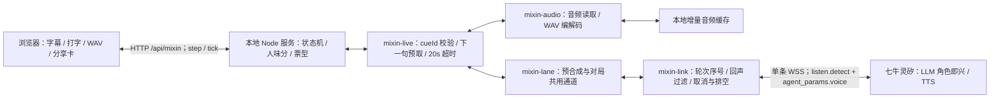
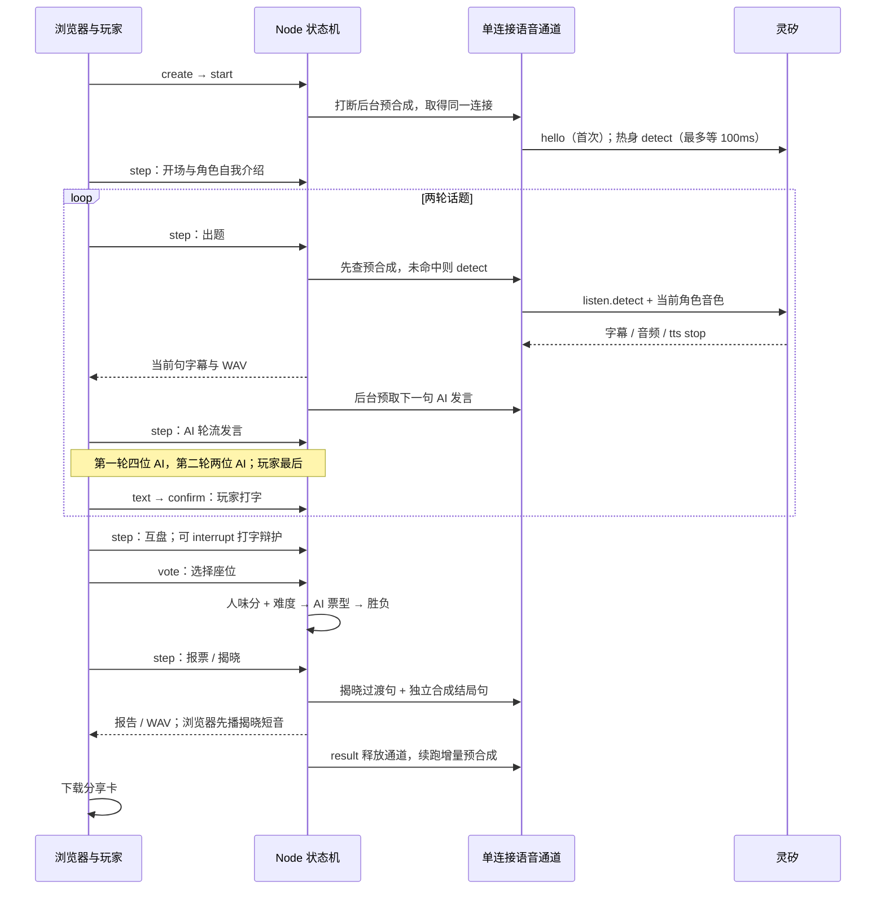
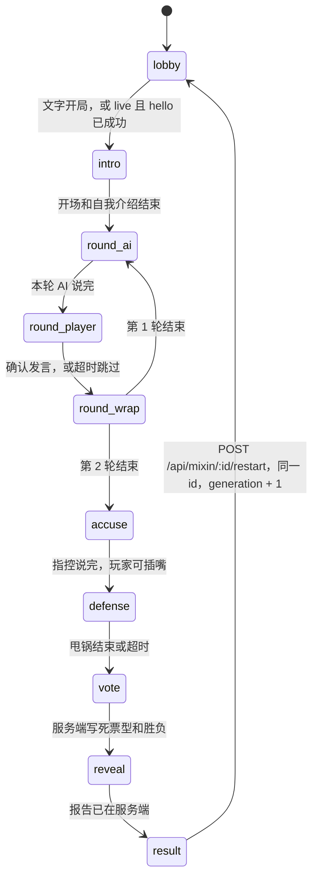

# 谁是人类 · 架构

服务端纯逻辑、文字局和语音局都在这里。主打入口是 `/mixin`；旧版「你是什么人类模型？」保留在 `/`。不带灵矽凭据时是文字局，不打开灵矽。带上凭据后执行 `npm run play:voice`，同一地址用一条连接打完语音局。换音色、预合成和这条连接按 [ADR-005 #14](https://github.com/Lq0412/qiniu-hks/issues/14) 的真机探针实现。

## 模块

| 模块 | 职责 |
| --- | --- |
| `mixin-game.mjs` | 对局状态机。身份、票型和胜负只在这里落账。露出 `stage`（与 `phase` 相同）和 `generation`。`enter` 失败会回滚；需要台词却没有台词时停在 `error`，避免空转。 |
| `humanity.mjs` | 确定性人味分、难度票型、`judgeOutcome`。同样的输入得到同样的票。匹配前先做转写归一化。 |
| `mixin-roles.mjs` | 虚构角色、关系梗、代号池、发牌。每个角色有 `voice`（描述和 `rate`），`voiceId` 来自音色表。 |
| `mixin-bank.mjs` | 三个场景、18 张话题卡、指控提示。卡上的回复不超过 40 字。 |
| `mixin-prompts.mjs` | `agentPrompt`（占位符是 `{{counter_brief}}`，与控制台提示一致）、开场白、64 条预合成清单、`renderBrief`、舞台指令。纯函数，不假设平台怎么投递。 |
| `mixin-voice.mjs` | 座位发言接口，以及按角色 id 索引的音色表。默认 8 秒超时，超时、抛错或空字符串都改用 `fallbackText`。 |
| `mixin-endings.mjs` | 揭晓口播。按胜负从定稿模板抽一条，填人味分、投票者和玩家原话。不调用模型。 |
| `mixin-session.mjs` | 文字会话。`playScript` / `runUntilResult` 跑完整局。`restart` 只在结局阶段重开。 |
| `mixin-http.mjs` | `/api/mixin`。和旧的 `/api/game`、`/voice` 分开，cookie 用 `mixin`。 |
| `mixin-live.mjs` | 语音会话。下一句后台预取，出题两段预合成拼接。有凭据时 `/api/mixin` 走这里，否则仍是文字会话。 |
| `mixin-lane.mjs` | 一台设备一条连接。启动时增量预合成，对局打断后复用同一条连接，结局释放后续跑。 |
| `public/mixin/` | 对局页面。原生 HTML/CSS/JS，不构建。`audio.js` 播放同源 WAV，揭晓短音在浏览器里合成。 |
| `scripts/presynth.mjs` | 按 id、文本、音色及文件存在性跳过已有音频，每句保存清单，打断后保留成果。 |
| `scripts/sim-mixin.mjs` | `npm run sim`。打印阶段、票型和结局字段。不连接灵矽。 |
| `scripts/play-voice.mjs` | `npm run play:voice`。没有凭据就退回文字局。 |

`server.mjs` 挂文字入口和语音入口：请求体上限 4096 字节，`/api/mixin/:id` 要求 cookie `mixin` 与路径里的 id 相同。只有传入灵矽凭据时才建立语音通道。`GET /mixin/audio/<文件名>` 只读预合成目录里的单层 `.wav`、`.mxop`、`.json`。`linx.mjs`、`game.mjs`、`scoring.mjs`、`benchmark.mjs` 不改行为。`public/` 里旧测评页不变。`npm start` 不读灵矽凭据，也不预合成。

## 总体架构



`mixin-voice.mjs` 提供角色音色表和纯发言接口；浏览器不直连灵矽。实时音频在服务端整句收齐后变成同源 WAV，尚未流式回包。预取利用浏览器播放上一句的时间提前合成下一句。取消后等待旧轮 `tts stop`，最多排空 3 秒，再发送下一轮。

## 一局时序



文字局省去语音通道及灵矽调用，使用同一状态机与服务端脚本台词。

## 数据流

文字局和语音局都由客户端调用推进。服务端没有自己的挂钟；到点不会自己往下走。`tick` 和 `step` 都是客户端打进来的。语音局的时钟同样从 0 开始。

```text
npm run sim，或没有凭据的 POST /api/mixin → createTextSession
有凭据的 POST /api/mixin → createVoiceSession（复用预合成那条连接）
  → createMixinGame（校验发牌、代号，代数号 1）
  → 客户端 POST .../start，再按阶段 POST .../step 或 .../tick
  → 每个 AI / 主持人回合：dispatchSeatSpeech → fulfillCue
  → 玩家回合：submitPlayerText → confirmPlayer（保留修订号）
  → 投票阶段 ensurePlan
       humanity.planVotes 算出四张 AI 票
       humanity.judgeOutcome 判胜负和甩锅大师
  → reveal 时服务端先写报告，再让主持人念
  → applyReportCopy 只能改文案；票数、胜负、aiScore 改不了
  → 结局后 POST .../restart：同一 id，generation + 1，回到 lobby
```

语音局是一条灵矽连接打完整局：hello 时注入一次 `{{counter_brief}}`，之后每个回合用 `listen.detect` 换座位和音色，不按阶段重连，也不重新 OTA。`npm run play:voice` 在有凭据时走这条连接；没有凭据时仍是上面的文字局。旧连接带着过期的 `generation` 来写局面时，状态机会拒绝。

## 状态机

玩家固定坐 5 号。两轮都是 AI 先说、玩家最后。演示局（`demo: true`）锁定普通难度、场景「模型年会」、话题卡 A2 再 A1、阵容柯老师 / 阿斯哥 / 深思哥 / 包包、代号「碳基-7B」。演示局里如果调用方仍然传了 `cardIds`、`roleIds` 或 `alias`，会先校验，不合法直接拒绝，不会静默换成演示牌。第 2 轮只留轮转后的前两名 AI。



任意阶段断开都会进入 `error`，`stage` 一起变成 `error`。重连回到断开前的阶段，刷新截止时间，不增加 `generation`。只有重开才会加一代。重开只接受结局阶段。

`enter` 先记下当前阶段。抛错时先恢复，再抛出。如果恢复之后这一阶段本来该有台词却没有（`intro`、`round_ai`、`round_wrap`、`accuse`、`reveal`），局面改停在 `error`，`tick` 不会空转。大厅里发牌失败仍留在 `lobby` 并抛错，不会建出一局冻住的会话。

## 建局白名单

HTTP 建局只接受 `demo`、`difficulty`、`seed`、`sceneId`、`cardIds`、`roleIds`、`alias`。多出来的字段返回 409，不建会话。`seed` 必须是整数。`difficulty` 必须是 `easy` / `normal` / `hell`；演示局仍会把难度收成普通。`roleIds` 必须是 4 个互不相同、可以上桌的 AI（柯老师、阿斯哥、深思哥、包包、小四），不能是群主或玩家。`cardIds` 必须是当前场景里的两张不同卡；没传 `sceneId` 且不是演示局时，两张卡同属一个场景才会推断场景。`alias` 要么在代号池里，要么洗成不超过 12 个汉字、拉丁字母、数字或连字符；洗完是空的就拒绝。`debug` 只在 `createMixinGame` 里打开，不在 HTTP 白名单里。

请求体超过 4096 字节返回 400。路径里的局 id 必须等于 cookie `mixin`，否则 409。会话超过 1 小时未更新会被清掉。`tick` 的 `now` 必须是不小于当前时刻的整数，`ms` 必须是 0 到 120000 的整数；时间不能倒退。

## 公开视图

揭晓（`reveal` / `result`）之前：

- `humanScore` 和 `aiScore` 是 `null`。
- `script` 是空数组。
- `votes` 只包含已经念出来的那几张票和对应计票。还没人报票时是 `null`。完整票型（含是否投给玩家）只在揭晓或 `debug` 时给出。
- 报票回合的公开舞台指令不写「我投 N 号」，只说请宣布投票。念完之后，这张票才出现在 `votes` 里。
- `trace` 只有 `phase` 和 `at`。
- 简报的局势写「身份和票型由系统固定，揭晓前不要猜测谁是人类」，不写胜负。
- `cue` 去掉 `fallbackText`。

`debug: true` 时分数和剧本提前可见。HTTP 建局传不了这个开关。

## 人味分

计分在 `humanity.mjs`，风格对齐旧的 `scoring.mjs`：多特征、词边界、容错区间，结果确定。不用「一看到某个字就加分」的松散规则。匹配前先 `normalizeForMatch`：全角折叠成半角；带分钟的时刻（`7:30`、`七点半`、`七点三十`、`七点三十分`、`7点30分`）收成 `H:MM`。点后面单独一个中文数字、后面不跟「分」，按十分钟计，所以「七点三」是 7:30，「三点五」是 3:50。只有这一支才看后面的量词或「刻」：「三点五倍」「一点五公里」「七点三刻」保持原样。「零」或「〇」再加一位数字仍是精确分钟，「七点零三」是 7:03。后面有「分」也是精确分钟，「十二点五分」仍是 12:05。`X点半`、`H:MM` 和两位分钟不看后面的字，「八点半只能到」是 8:30，「九点半千万别迟到」是 9:30。阿拉伯数字不乘十。单独的「两」「二」收成 `2`，但紧跟在已经收成的时刻后面时不收，「七点半两个人」是 7:30两个人。不改裸的「N点」（所以「有一点」不动），不改「十二」「二十」「第二」。小时大于 23 或分钟大于 59 保持原样。前一个字已经是数字时不再起一个时刻，所以「99点半」不会被看成「9:30」。标点只折叠、不删掉，所以「我，妈」不会变成「我妈」。

- 生活说法要整词，例如「我昨天」「我妈」「下班」。单独的「饿」「困」不加分，所以「饥饿」「困难」不会被误判。「我」或「我家」后面接亲属或宠物（妈、爸、奶奶、爷爷、猫、狗等），再接具体的东西或事，也算生活说法，例如「我妈的手机」「我爸昨天」「我家猫把杯子打了」。这条和别的生活说法共用同一份 +2，一句话命中多次也只加一次。「其他妈妈」「他妈妈来了」不含「我」，不算。单独的「我爸」后面没有具体的事，不加分。
- 脏话和身份词有前后排除字。「他妈」后面是「妈」不算（挡住「他妈妈」「其他妈妈」）。「妈的」前面是「我爸奶妈姑姨舅婶干后继岳」不算（挡住「我妈的手机」）。「我是人类」后面是「学」不算，「我是人类学家」不加身份分。「我是真人」后面是「秀」不算。「我就是人类」单独成条，后面是「学」不算，所以「我就是人类学家」不加分；「我就是人类」仍然算身份暴露。「我就是人」后面是「类才工员家民生道性事群口」，「类」交给上面那条，所以「我就是人才」不加分，也不会从短规则把「人类学家」算进去。
- 数字和拉丁词有边界。「18点」不命中「8点」，「EMAIL」不命中「AI」。「晚上8点见」仍命中「8点」。
- 语气词要凑够两个才加 1 分。「也就是」里的「就是」不算。「哈哈」只算笑声，不再同时算语气词。
- 身份暴露或脏话加 3 分，不再叠加情绪分。
- 停顿看标记：跳过 +2，主动要提示 +1。8 秒自动展开的示例只把 `hintReleased` 设为真，不记 `usedHint`。只有玩家自己调用提示才记 `hintTaken`。每一轮开始时 `hintTaken` 清回 false，上一轮要过提示不会带到下一轮。没有标记时，沉默要超过 12.5 秒或 20.5 秒才加分，留 500 毫秒余量。
- 时长惩罚只在非打字、且时长落在 4.25 秒到 11.75 秒之间。文字模式默认 `typed: true`，不吃这条。
- 冷静复述要在辩护阶段、没有情绪词，并且和别人的原话有至少 6 个有效字重合。
- AI 腔（「作为一个语言模型」「首先…其次」「希望对你有帮助」等）、结构化分点、免责声明、命中话题卡关键词，分别扣分。AI 腔合计最多扣 3 分。

每句从 0 开始：身份暴露或脏话 +3（不叠情绪），否则情绪 +1；两个以上语气词 +1，生活细节 +2，笑声 +1，跳过 +2 / 主动提示 +1；打断超过 30 个有效字或含「我不是」「凭什么」+1；非空短于 4 字或超过 60 字 +1。AI 腔按类别最多 -3，结构化分点、免责声明、命中题卡关键词各 -1；非打字且时长 4.25–11.75 秒 -1；符合条件的冷静引用辩护 -1。各句相加得到人味分，可为负。

`aiScore = clamp(100 - 人味分 × 10, 0, 100)`。旧版 `scoring.mjs` 是另一套六题事实台账与能力格条（幻觉 3、上下文 4、指令 3），不参与本局人味分；两者共同采用服务端可复核规则，而不是 LLM 自由打分。

## 胜负与计票（ADR-007）

`humanity.mjs` 计算票型和胜负。`mixin-game.mjs` 的 `ensurePlan` 把结果写进对局。模型只能念，不能改。

- 被识破：5 号拿到的 AI 票 ≥2，并且是最高票。并列最高也算被识破。否则潜伏成功。1 票即使并列最高，也不算被识破。
- 结局上的 `x/4` 只数这 4 张 AI 票。玩家自己投给谁，不进入这 4 票。
- 简单档：人味分 ≥5 给 2 票，3–4 分给 1 票，低于 3 分给 0 票。
- 普通档：识破给 3 票，否则 1 票。阈值是人味分 ≥3。
- 地狱档：识破给 4 票，否则 0 票。阈值是人味分 ≥1。
- 甩锅大师只在潜伏成功，并且玩家投中的座位是 AI 票里严格第二高。0 票不算第二。弃权不算。已经被识破时，即使投中第二也不算。并列第二的座位都算。

票怎么分到座位上：优先把票堆给替罪羊以外的低号位，替罪羊再投自己的关系对手；对手不在桌上就投另一个不是自己的座位。没有人投自己。

## 超时与兜底

每个等待都有截止时间，但要等客户端调用 `tick` 或 `step` 才会推进。语音局也一样。纯发言接口 `mixin-voice.mjs` 中，AI 或主持人没说出字、抛错，或超过 8 秒，就用该回合的 `fallbackText`，并在跳过时补一句「N号模型正在深度思考，先跳过。」玩家 15 秒是界面文案，20 秒才是硬跳过。空转写先给一次重说。揭晓阶段一开始就把报告写好，主持人念失败也不影响结算。`mixin-live.mjs` 语音合成每段默认等待 20 秒（从 detect 真正发出时计时）；超时或没有音频时只留字幕。

## 回声

开场白和舞台指令可能被语音识别原样送回来。回合开始时记下舞台指令和兜底台词，发言落地后再记下说出的字。`isStageEcho` 去掉空白和标点、忽略大小写后比对：完全一致，或两边都不短于 12 字且重叠达到较长一侧的 72%，就丢掉。含「舞台指令」、`counter_brief` 或旧字段名 `game_brief` 的也丢掉。调用方可以挂 `isStageEcho(text, game)`：返回 true 强制当回声，false 放行，不返回则走默认规则。经 `listen.detect` 注入的文字也会被识别成玩家语音。语音局把这段原文交给同一套过滤：空的、含「【台词】」或「舞台指令」、或是注入回声的识别结果，不会变成玩家的话，脚本句改用服务端台词。

## 语音调度（#14）

真机探针的结论已经接到 `mixin-link.mjs`、`mixin-lane.mjs` 和 `mixin-live.mjs`。一台设备只开一条 WebSocket。第二条会把第一条挤掉，所以预合成和对局共用这一条：对局开始时 `abort` 掉正在合成的那句，立即取得同一条连接，后续 detect 由连接层排空后发送。不另开第二条。

- 同一台设备只保持一条 WebSocket。第二条会把第一条踢掉。
- 每个回合在 `listen.detect` 上用 `agent_params.voice.id` 换音色。这个 id 是字符串。
- 服务端把当前局势写进每一次 detect 的文本。`custom_replace_prompt` 只在 hello 设置一次，字段是 `counter_brief`。listen 上不再带它。占位符是 `{{counter_brief}}`，必须和控制台提示词一致。hello 里 `features.mcp` 为 false。
- 不依赖 MCP。控制台提示要求模型不调工具。揭晓口播由 `mixin-endings.mjs` 生成，不走 `self.game.report`。
- detect 文本的约定：必须逐字念的内容用「【台词】」包起来，包括群主的固定台词、指控里的原话、报票。只给角色和话题时，模型最多用角色口吻说两句，句末是「一句话，20字以内。」
- 经 detect 注入的文字会以语音识别结果回来，必须滤掉。脚本句落地用 `cue.line`，不用模型改写后的字。
- 打断发送 `{ type: 'abort', reason: 'wake_word_detected' }`。打断后的那一步不交出可播放的音频。
- 前端用「思考」音效和字幕提示等待。开局热身总共最多等 100ms（含排队），只取消该轮热身，不挡住开局；合成超时从实际发送 detect 起计。
- 早期探针中群主音色首音曾为 3.0–3.5 秒（历史观察，不是当前整局延迟承诺）。第一次 `npm run play:voice` 会在后台增量预合成群主台词，不挡住开局。扩充后的全量耗时需真机验收，不能再用旧清单约 90 秒估计。文件写到 `public/mixin/audio/`，已在 `.gitignore` 里，不要提交。文件还没好，或这一句不在清单里，群主就走实时合成。
- 灵矽服务端有 TTS 缓存：同一句话用同一音色，第二次合成的音频与第一次完全一致。预合成文件是本机退路，不依赖这次缓存还在。
- 音色 ID 写在 `mixin-voice.mjs`，按角色 id 索引，全部是字符串（纯数字 ID 不能转成数字）。群主·零号用典型播音女 `4bdb867c07d54e119950b5bda44673a7`，一局里固定不换。柯老师用温暖治愈女 `8fca6d5172fc4c309c2d16352ca8a9b3`，备选积极知性女 `b30165086267413f96643a803aed599f`。阿斯哥用沉稳质感男 `2e7965636b0d4472ae51e75f419dff41`。深思哥用深夜播客 `b38d4a6eb8f64c209fa6febfd7f91663`，没有备选。包包用调皮公主 `1965294143278125057`，备选活泼女孩 2.0 `2077603629237219330`。小四用稚气呆板女 `91ccc0758b22473693dfa86c8e7e3fa3`。备选只记在表里，失败时不自动换。
- 对局里的音色覆盖用环境变量 `MIXIN_VOICE_IDS`。格式是 `角色id=音色id`，多项用英文逗号分隔，例如 `claudia=8fca6d5172fc4c309c2d16352ca8a9b3,baobao=1965294143278125057`。等号两侧可以有空格。值按字符串读取。缺等号或空 id 的项忽略，没写到的角色继续用表里的默认 id。
- 语音探针用另一个变量 `LINX_VOICE_IDS`。那是按位置排列的音色 id，英文逗号分隔，顺序见探针脚本。探针不会读 `MIXIN_VOICE_IDS`，对局也不会读 `LINX_VOICE_IDS`。

取消与排空：每轮 detect 分配递增序号，取消时立即结束调用者的等待，并把该轮放入排空状态。音频、字幕和 stop 在排空期间不交给下一轮；收到旧轮 stop，或等到 `settleMs`（默认 3000ms）才发送排队的 detect。同一连接上的 detect 串行，重复取消不会让等待中的旧请求迟发。排空窗口之后才到的迟到帧仍可能混入，协议没有可用于逐帧归属的轮次字段。

下一句预取：`step()` 的 `finish()` 调用 `fulfillCue()` 后，`shiftCue()` 已把下一句的 situation 和 instruction 定稿（answer 的 spoken 也已更新；当前提示词未嵌入 spoken）。只要还有 cue 且未到 result，就立即后台调用 `speakCue()`，按 cueId 保存 promise。预取不落地局面，下一次 step 复用结果，仍用该次 step 的 now 落地。cueId 不匹配、tick 跳过、interrupt、restart 或 result 都作废预取；未完成时调用 `cancelTurn()` 让出连接，interrupt 原有 `abort()` 保留。失败被捕获，超时、无音频只留字幕，断线沿用原来的重连重试。预取只掩盖播放上一句的时间，首句和玩家发言后的第一句仍需等待。没有做流式回包。

预合成清单保持原 11 条最前，再加入 3 个场景 × 4 个玩家代号的 12 条开场白、18 张题卡 × 第 1/2 题的 36 条出题段，以及 5 个 AI 名字的「请{name}先来。」段，共 64 条（其中默认开场白文本重复，id 各自稳定）。host_card 优先命中整句，否则两段都命中同一群主音色时拼接 PCM，中间加 150ms 静音；缺任意一段或原句被 90 字截断时走实时合成。预合成条目的 `ttsHash` 由 `ttsKey` 对实际 detect 中净化后的台词与音色计算 SHA-256，取前 16 位十六进制；运行时命中也校验该哈希，旧条目缺少或不匹配时走实时合成。增量预合成仅跳过 manifest 中 id、文本、音色、ttsHash 相同且文件存在的条目，每完成一句就保存包含旧条目的清单，打断或后续失败不会丢掉已经保存的成果。

对局到 result 时先作废并取消预取，再 `lane.releaseGame()`；通道回到 idle 后自动续跑增量预合成。下一局可再次打断续跑，仍用同一条连接。result 不再发起对局 detect，后台预合成可以继续 detect。结局后的 restart 在下一次 start 重新取得通道。当前中途不能 restart；HTTP TTL 删除会话和新建另一局尚无语音所有权交接或显式弃局释放，旧局可能继续占用或争用连接，需要后续补会话生命周期管理。

揭晓顺序固定：浏览器先合成约 0.36 秒短音，再播群主的「投票结束，揭晓时间。」（有预合成文件就用文件，否则实时），最后实时念结局口播。短音不写进这段 WAV，避免响两次。过渡段用 `timeoutMs`，结局段独立用 `revealTimeoutMs`（默认等于 `timeoutMs`），两段各自启动计时；过渡超时仍尝试结局，结局失败仍保留过渡音频。

指控、念票和群主固定台词都由服务端先套成「【台词】」再送 detect，引用用服务端原文。

固定台词统一经过 `scriptedDetect`，每条 detect 都要求一字不增不减，禁止改写、展开列表及套用角色风格。固定 detect 不携带 personality 或口头禅指令；即兴轮仍保留 persona。GPT 固定指控与念票模板使用普通措辞，不再拼 keycap 列表。仓库现有语音链路使用 `listen.detect`，没有已验证的纯 TTS 接口，逐字效果仍需真机验收。

`sanitizeForTts` 统一处理名字读音（Claude→克劳德、Cursor→科瑟、DeepSeek→深度求索，GPT/Gemini 保持英文）、1–99 的整数「N号」及 emoji。普通数字、小数和更长编号保持原样；该转换也用于回声归一化与 `ttsKey`，保证朗读、回声和预合成哈希一致。净化还会合并连续空白、清除中文标点两侧空白并去掉首尾空白。服务端即兴模型文本显示时，用同一名字映射表反向恢复英文名，`spokenText` 与回声仍按实际朗读正文净化；固定台词和玩家原话不改写。指控引用沿用已恢复的 AI 记录，模型 report 的自由文案同样恢复英文名并保留玩家引用；`human.breakdown.quote` 来自玩家原话，保持原样。题号在服务端正文及预合成目录中直接写为「第一题／第二题」，host_card 拆段匹配同样使用中文题号。

状态与 transcript 的对应关系：`viewMixin().cue` 增加 `text` / `spokenText`，仅公开已知固定台词；即兴 cue 与未公布的 vote cue 两字段均为 null。`game.lines[]`、由 cue 落地的 `game.dialogue[]` 及对外 `viewMixin().dialogue[]` 在 `text` 旁增加 `spokenText = sanitizeForTts(text)`；玩家输入和无 TTS 的系统行在对外 dialogue 中为 null。预合成 manifest 的 TTS 条目也增加 `spokenText`。该字段表示净化后的朗读正文，不包括角色和局势指令；不代表已从音频验证模型确实逐字朗读。字幕消费者可用 `spokenText ?? text`，显示名仍用英文 `name`。音频失败或文字局的 cue 记录仍提供预期朗读正文。

前端由队长接入（本次不修改 `public/mixin/`）：
- `public/mixin/logic.js:166` 的 cue 映射保留新增 `text`、`spokenText`（允许 null）；`:190` 的 dialogue 映射保留 `spokenText`；`:264` 的 `subtitleModel` 用 `line.spokenText ?? line.text` 计算字幕内容和长度。
- `public/mixin/app.js:660` 的发言气泡和 `:706` 的群主话题字幕使用 `spokenText ?? text`；`:914` 的 transcript 可在原文旁增加朗读正文（不同于原文时显示），保留原文与 emoji。角色标签仍使用 `name`。
- `public/mixin/` 未发现生成「第1题」的文案，无需前端改题号。上述行号以本次基线为准。

本次修复来自 #29 真机回归：`9ab9897` 将 GPT 的 keycap 列表引入固定指控与投票口头禅，并在 `buildMixinDetect` 新增净化，把 keycap 变成连续「第一、第二、第三、」。对比 `2c282d8`，`scriptedDetect` 本身未变化，仍只有角色、台词和局势，逐字要求仅存在全局 agentPrompt。固定 detect 没有携带 persona，因此不能认定 persona 直接泄漏；可确认的回归诱因是列表正文和净化后的序数形式，以及每条请求缺少逐字约束，不能仅凭代码解释全部模型改写。需要重新运行 presynth（名字、座位读法及题号改变对应哈希），再验收固定台词逐字、名字读音与题号 ASR。


## 结局口播（ADR-008）

[ADR-008 #19](https://github.com/Lq0412/qiniu-hks/issues/19) 规定揭晓口播由服务端生成。`beginReveal` 调用 `mixin-endings.mjs`，把填好的文本放进揭晓 cue，舞台指令是「【台词】」加上这段口播，兜底台词也是这段口播。模型只照念。文案生成不走 LLM，也不走 MCP；语音仍由灵矽照念。

- 被识破从 C1–C5 里抽 1 条。潜伏成功且五号 0 票时只从 S1、S3、S4 里抽。有票时 S1–S5 都可以。随机数可以注入。同一会话最近 3 局尽量不重复；三条候选都被用过时才允许重复。重开会带上这份记录。
- `{玩家原话}`：被识破取最暴露人类的一句（leakQuote），潜伏成功取最像 AI 的一句（bestAiQuote）。先按人味分规则选句，再截到不超过 14 字。被识破时超长原话取包含命中片段的一截，优先在标点处断开，所以「我昨天加班到很晚」不会只剩「我昨天」。潜伏成功仍取最像 AI 的短片段。模板里已经有引号。玩家原话含脏话时整句换成「（已和谐）」，词表和词边界都用 `humanity.mjs`，所以「其他妈妈」不会被误伤。全程没说话时填「……」。原话里的半角、全角花括号先去掉，所以玩家说「{好}」不会把占位符检查卡住。
- `{人味分}` 填不小于 0 的整数，负数口播成 0。`{投票者}`：1 人写名字，2 人用「和」连接；3–4 人时 C2 写「全桌」，C3 写「三位同事」或「四位同事」，其余条目写「全桌」。被识破时投票者一定有值。先填这两处，最后才写入玩家原话，避免原话里的「{人味分}」被再替换一次。
- 花括号检查只针对模板本身：去掉 `{玩家原话}`、`{人味分}`、`{投票者}` 之后不能再有花括号。填完的口播不再做这次检查。生成若抛错，记一条日志，改念「揭晓完毕。五号的胜负和人味分以系统记录为准。」对局照常揭晓，这次不写入结局编号。
- 分享卡称号仍按称号池选取，和口播文本互不影响。
- 揭晓前公开视图里没有口播。`report` 在揭晓前是 null，口播只在进入揭晓、写好 cue 之后出现。

## 玩家代号

代号是内容选择，不是架构决策。演示局锁定「碳基-7B」。其它局从「碳基-7B / 打工人-Turbo / 摸鱼-mini / 熬夜-Pro」里抽。没传种子时种子是 1，抽签可复现。调用方也可以直接指定 `alias`，规则见上面的白名单。

## 前端

文字局页面在 `public/mixin/`，没有框架，也没有构建。`server.mjs` 把 `/mixin`、`/mixin/` 和页面资源原样送出去。旧测评仍在 `/`。

| 文件 | 职责 |
| --- | --- |
| `public/mixin/index.html` | 页面 |
| `public/mixin/app.js` | 渲染、倒计时、调用顺序 |
| `public/mixin/logic.js` | 纯函数：建局参数、公开视图裁剪、座位、字幕、推进意图、分享卡绘制 |
| `public/mixin/audio.js` | 播放同源 WAV、停止、思考音。揭晓短音用 WebAudio 合成。按住说话是空函数，不调用 `getUserMedia` |
| `public/mixin/style.css` | 深色牌桌 |

打开 http://127.0.0.1:4173/mixin 。选场景和难度，输入或随机一个化名，开始。请求是 `POST /api/mixin` 再 `POST /api/mixin/:id/start`。局 id 用创建响应里的 `id`，不是 `game.id`。cookie `mixin` 由浏览器保存。

推进由页面驱动，服务端没有自己的挂钟：

- 有 `cue`：先显示「思考中…」，调用 `playThinking()`，再 `POST .../step`。刚说完的一句会先停一停，长开场白停得更久。
- 没有 `cue`：大约每秒 `POST .../tick`，正文是 `{ ms: 1000 }`。客户端自己记时钟，刷新后从 `sessionStorage` 读回来。
- `round_player`：`text`（`typed: true`）再 `confirm`。可以 `hint`。8 秒后的示例只用服务端返回的 `example`。
- `accuse`：可以 `interrupt`。
- `defense` / 还没锁票的 `vote`：`vote`，座位是 1–4。
- 念票时只渲染公开视图里已经出现的 `votes`。揭晓前不补全没念出来的票。
- `reveal` 或 `result`：展示 `report` 里的口播、人味分、称号和 `report.quote`。这句引语和口播 `endingText` 里的那句相同，空话是「……」。再来一局是 `restart` 再 `start`。分享卡用 canvas 画 PNG，没有二维码。

揭晓前 `sanitizeView` 会丢掉 `humanScore`、`aiScore`、`script`、`report`、`outcome`，也不会把 `examplePlayer`、舞台指令、`fallbackText` 放进界面状态。`sessionStorage` 只存局 id 和时钟。409（cookie 对不上或规则拒绝）和 403（不是本机）用 `friendlyError` 提示。断线或刷新后用原来的 cookie 再 `GET /api/mixin/:id`。

如果 step 响应里带了字符串 `audioUrl` 或 `clip.url`，页面会 `await play(url, speechPlay(cue))`。`seat`、`roleId`、`voiceId` 都来自这一步之前的当前 cue；`sanitizeView` 只保留 `cue.voice.voiceId`。文字模式没有音频字段。按住说话按钮调用 `startHoldToTalk` / `stopHoldToTalk`，这两个函数是空的，不上传录音。

### 浏览器音频协议

`public/mixin/audio.js` 的导出名不变。页面只播同源地址。页面资源的 CSP 是 `default-src 'self'`。浏览器拿到的对白是 WAV，不是原始 mxop。

- `play(url, options)` 返回 `Promise<void>`。`url` 去掉空白后如果是空字符串，直接结束。调用时先 `stop()` 掉上一句。`options.seat`：0 是群主，1–4 是 AI，5 是玩家。`options.roleId`：`host` / `claudia` / `astra` / `shensi` / `baobao` / `xiaosi` / `player`。`options.voiceId` 按字符串使用，纯数字也不要转成 number。只有自然播完才调用 `options.onEnded`。`stop()` 打断时不调用。没有 `Audio` 的环境直接结束，也不调用 `onEnded`。
- 地址带 `reveal=1`，或是 `webaudio:reveal`：先用 WebAudio 合成约 0.36 秒、880Hz 加 1320Hz 的短音，再播后面的 WAV。`webaudio:` 开头的地址本身不请求网络。短音被打断时，后面的 WAV 也不再播。
- `stop()` 只停对白，不停思考音。
- `playThinking()` / `stopThinking()`：座位切换时的循环思考音。没有 `AudioContext` 时什么都不做。重复调用 `playThinking()` 只保留一层。
- `startHoldToTalk(handlers)` / `stopHoldToTalk()`：空函数。页面按住说话只传 `onError`，不传 `onStop`。玩家在输入框打字，然后点确认。
- 一句语音的地址是 `audioUrl`，与 `clip.url` 相同，形如 `/api/mixin/<局id>/clip/<片段id>`。揭晓这一句再加 `?reveal=1`。读取要带 cookie `mixin`，否则 409。预合成静态文件是 `GET /mixin/audio/<文件名>`，不需要这张 cookie。文件名只能是一层，后缀只能是 `.wav`、`.mxop`、`.json`。`.` 开头和带目录的名字不提供。

## 怎么跑

```bash
npm run sim
npm run sim -- --stealth
npm run sim -- --difficulty hell --seed 3
```

默认是演示局，难度锁在普通，代号是「碳基-7B」。`--stealth` 或传入 `--difficulty` 都会关掉演示锁，改用固定的年会阵容（A2、A1，柯老师 / 阿斯哥 / 深思哥 / 包包），这样难度参数才会生效。`--stealth` 另用一套低人味台词，用来看潜伏成功。三条都不连灵矽，也不要麦克风。

真机语音版：

```bash
export LINX_DEVICE_JSON='<设备 JSON 正文或文件路径>'
export LINX_API_KEY='<API key>'
npm run play:voice
```

需要 Node.js 24、上面的设备 JSON（也可以是文件路径，或仓库根目录已被忽略的 `.linx-device.json`）、`LINX_API_KEY`，以及浏览器允许播放声音。无需麦克风权限；这一局不上传「按住说话」的录音，玩家在输入框打字并点确认。第一次启动会在后台增量预合成，需预留几分钟；已有条目会跳过，全量耗时不作固定承诺。打开命令打印的地址，默认是 http://127.0.0.1:4173/mixin 。`PORT` 改端口。不要设置 `LINX_WS_URL`；不要同时打开首页语音或另跑一个预合成进程。没有凭据时同一条命令退回文字局，不连接灵矽。

## 分工

单人参赛，AI 小队协助：大王统筹与审查，小策设计玩法，小码开发，小演负责路演。开发工具从 Cursor 云端助理转到共享电脑上的 Codex，过程见 [AI 工程实践](ai-engineering.md)。

## AI 协作方式

架构决定写在 ADR issue 里。一个任务对应一个分支、一个 PR。先开 Draft，再以小步提交推进。审查者只读审查，列出必须修改的项，实现侧按清单改完再交下一轮。真机探针和云端离线测试分开跑，探针结论写回架构，不把未测过的平台行为写进代码。[#16](https://github.com/Lq0412/qiniu-hks/pull/16) 就是按这个方式做的：先交文字模式，审查列出词边界、建局白名单和视图泄露，探针 #14 的结论再补进同一条分支。

## 决策记录

- [ADR-001 作品方向：从「人类模型测评」转向「谁是人类」（混入模型群）](https://github.com/Lq0412/qiniu-hks/issues/10)：方向定为「谁是人类」，玩家假装是 5 号，旧版留作可玩兜底。
- [ADR-002 分支与交付策略：main 保留旧版兜底，新玩法走特性分支](https://github.com/Lq0412/qiniu-hks/issues/11)：`main` 保持旧游戏可玩，新玩法在 `feat/mixin-core`，语音探针在 `feat/voice-probe`，界面以后另开分支，改动都走 PR。
- [ADR-003 运行形态：Web 端 + 按住说话，文字模式不依赖麦克风](https://github.com/Lq0412/qiniu-hks/issues/12)：决策目标是 Web + 按住说话；当前实现两种模式都打字，按钮尚未接入录音，文字模式不调用 `getUserMedia`。
- [ADR-004 对局核心：服务端状态机 + 人味分，不用死关键词，每阶段超时兜底](https://github.com/Lq0412/qiniu-hks/issues/13)：服务端状态机露出阶段和代数号，人味分加难度决定票，每阶段都有超时兜底，并提供 `npm run sim`。推进由客户端 `tick` / `step` 触发。
- [ADR-005 语音调度：一局保持单条灵矽连接，每回合换音色，固定话术预合成兜底（已决定）](https://github.com/Lq0412/qiniu-hks/issues/14)：一局一条灵矽连接，不按阶段重连、不重新 OTA。探针已测出 detect 换音色、`{{counter_brief}}` 只在 hello 注入、首音延迟和 TTS 缓存。语音局已按此实现。
- [ADR-006 凭据处理：灵矽设备凭据只在运行时注入，不进仓库](https://github.com/Lq0412/qiniu-hks/issues/15)：灵矽凭据不入库、不进日志，离线测试和 CI 不依赖它们。
- [ADR-007 胜负判定与计票口径](https://github.com/Lq0412/qiniu-hks/issues/18)：胜负和计票采用方案 A。5 号 AI 票 ≥2 且为最高（并列也算）才是被识破；简单档按人味分给 2 / 1 / 0 票，普通档 3 或 1，地狱档 4 或 0；甩锅大师只在潜伏成功且投中严格第二高。
- [ADR-008 LLM 只负责配音和角色即兴，流程与关键文案由服务端确定](https://github.com/Lq0412/qiniu-hks/issues/19)：揭晓口播由服务端按定稿模板生成，以「【台词】」交给群主照念。0 票只抽 S1、S3、S4。称号池和口播分开。揭晓前不把口播放进公开视图。

## 当前限制

- 页面仍由客户端 `tick` / `step` 推进，没有服务端挂钟。
- 「按住说话」不上传录音。语音局和文字局都是打字后点确认。
- 旧版六题页的连接仍在 `linx.mjs`，和这场对局分开。`[mcp拒绝]` 记在那条旧连接上。

## 真机验收记录与适用范围

来源：只读资料 `voice-probe-results.md` 最后两节，北京时间 2026-10-25。等待是 API step 等到整句合成返回的耗时，不是平台首音延迟；有节奏的驱动会等待音频播放时长与浏览器停顿，让预取有时间工作。

| 测试 | 条件 | 结果 |
| --- | --- | --- |
| PR #24 @ `df18bfc`，01:09–01:32 的 F 局 | 预合成满 64 句，按浏览器节奏 | 27 句，0 无声，0 声线错；等待 p50 5ms / p90 4.3s；整局 262s（约 4.4 分钟）。对比 PR #23：p50 6–7s，整局约 7 分钟。 |
| PR #24 @ `68a9301`，01:42–02:02 的复验 F 局 | 正式 20s 超时，缓存删一半，开局时预合成在跑，按浏览器节奏 | start 106ms（修复前 E 局 19.0s）；27 句 0 无声、0 声线错；等待 p50 4ms / p90 3.6s；全程 1 条外连。 |
| 同次复验 H 局 | 临时副本 9s 超时，按浏览器节奏 | 4/27 句无声，均为 accuse 长句；超时后的下一句有声。揭晓只有过渡音频，结局长句仍超时，因此不能把「其余句有声」解释为结局完整。 |

这些是特定提交、缓存和节奏条件下的记录，不是所有环境的性能保证。本次文档提交仅跑云端离线测试与文字模拟，测试只用假 WSS，不连接真机。音色实际听感、浏览器播放与打断、预合成中途开局及结局续跑、超时后下一句恢复、完整揭晓口播仍需真机验收；玩家麦克风输入尚未接入，不列为已验收功能。

## 后端资源与结算字段补充

- `GET /mixin/assets/*` 从 `public/mixin/assets` 提供图片，测试可注入 `createApp({ assetDir })`；拒绝路径穿越，缺失返回 404。不改变语音资源路由。
- 玩家投票接受 `{seat:null}` 或 `{skip:true}`，以 `playerAbstained` 区分尚未投票。AI 每票有 5% 弃权概率，使用由 seed 派生的独立 RNG；其余目标分配不变。AI 弃权不计入座位 tally，以 `abstentions` 单列；弃权达到最高（含并列）时无人被识破。玩家票仍只影响甩锅大师。
- 揭晓后的 `game.human.breakdown` 按现有 humanity 规则列出 `{label,delta,quote,id,kind,round}`，总和等于未截断的 `human.score`。旧六题 scoring.mjs 属于不同测评，不参与此游戏。
- 角色 id 与音色目录不变，显示名改为 Claude / GPT / DeepSeek / Cursor / Gemini，玩家默认牛小七；显式 alias 仍保留。前端硬编码名单、弃权按钮与明细展示留给前端 PR。
