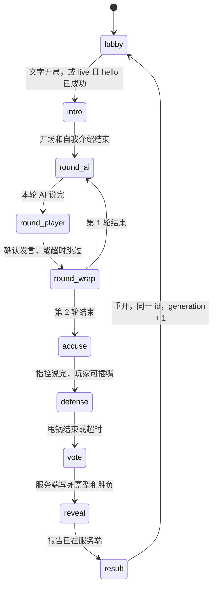

# 谁是人类 · 架构草案

这一步只交付服务端纯逻辑和文字模式。旧版「你是什么人类模型？」仍是 `npm start` 的默认真玩入口。新对局不打开灵矽、不申请麦克风。会话内换音色还在探针分支上，这里只规定座位怎么说话。

## 模块

| 模块 | 职责 |
| --- | --- |
| `mixin-game.mjs` | 对局状态机。身份、票型和胜负只在这里落账。露出 `stage`（与 `phase` 相同）和 `generation`。 |
| `humanity.mjs` | 确定性人味分、难度票型、`judgeOutcome`。同样的输入得到同样的票。 |
| `mixin-roles.mjs` | 虚构角色、关系梗、代号池、发牌。每个角色留 `voice` 槽，`voiceId` 为空，`verified` 为 false。 |
| `mixin-bank.mjs` | 三个场景、18 张话题卡、指控提示。卡上的回复不超过 40 字。 |
| `mixin-prompts.mjs` | `agentPrompt`（含 `{{game_brief}}`）、开场白、`renderBrief`、舞台指令。纯函数，不假设平台怎么投递。 |
| `mixin-voice.mjs` | 座位发言接口。调用方只说「这个座位用这份音色说这段指令」。 |
| `mixin-session.mjs` | 文字会话。`playScript` / `runUntilResult` 跑完整局。 |
| `mixin-http.mjs` | `/api/mixin`。和旧的 `/api/game`、`/voice` 分开，cookie 用 `mixin`。 |
| `scripts/sim-mixin.mjs` | `npm run sim`。打印阶段、票型和结局字段。 |

`server.mjs` 只多挂了文字入口。`linx.mjs`、`game.mjs`、`scoring.mjs`、`benchmark.mjs` 和 `public/` 这一步不改行为。

## 数据流

文字局：

```text
npm run sim 或 POST /api/mixin
  → createTextSession
  → createMixinGame（发牌、代号、代数号 1）
  → 每个 AI / 主持人回合：dispatchSeatSpeech → fulfillCue
  → 玩家回合：submitPlayerText → confirmPlayer（保留修订号）
  → 投票阶段 ensurePlan
       humanity.planVotes 算出四张 AI 票
       humanity.judgeOutcome 判胜负和甩锅大师
  → reveal 时服务端先写报告，再让主持人念
  → applyReportCopy 只能改文案；票数、胜负、aiScore 改不了
```

以后的真语音局打算是一条灵矽连接打完整局：hello 时注入一次 `{{game_brief}}`，之后用舞台指令换座位，不按阶段重连，也不重新 OTA。这一步不实现这条连接。旧连接带着过期的 `generation` 来写局面时，状态机会拒绝。

## 状态机

玩家固定坐 5 号。两轮都是 AI 先说、玩家最后。演示局（`demo: true`）锁定普通难度、场景「模型年会」、话题卡 A2 再 A1、阵容柯老师 / 阿斯哥 / 深思哥 / 包包；第 2 轮只留轮转后的前两名 AI。



任意阶段断开都会进入 `error`，`stage` 一起变成 `error`。重连回到断开前的阶段，刷新截止时间，不增加 `generation`。只有重开才会加一代。

公开视图在揭晓前不包含胜负和票型，简报也不写谁是人类。`cue` 给调用方时去掉 `fallbackText`，避免兜底台词被当成玩家该说的原文。

## 人味分

计分在 `humanity.mjs`，风格对齐旧的 `scoring.mjs`：多特征、词边界、容错区间，结果确定。不用「一看到某个字就加分」的松散规则。

- 生活说法要整词，例如「我昨天」「我妈」。单独的「饿」「困」不加分，所以「饥饿」「困难」不会被误判。
- 数字和拉丁词有边界。「18点」不命中「8点」，「EMAIL」不命中「AI」。
- 语气词要凑够两个才加 1 分。「也就是」里的「就是」不算。
- 身份暴露或脏话加 3 分，不再叠加情绪分。
- 停顿看标记：跳过 +2，提示 +1。没有标记时，沉默要超过 12.5 秒或 20.5 秒才加分，留 500 毫秒余量。
- 时长惩罚只在非打字、且时长落在 4.25 秒到 11.75 秒之间。文字模式默认 `typed: true`，不吃这条。
- 冷静复述要在辩护阶段、没有情绪词，并且和别人的原话有至少 6 个有效字重合。
- AI 腔（「作为一个语言模型」「首先…其次」「希望对你有帮助」等）、结构化分点、免责声明、命中话题卡关键词，分别扣分。AI 腔合计最多扣 3 分。

`aiScore = clamp(100 - 人味分 × 10, 0, 100)`。

## 胜负与计票（ADR-007）

`humanity.mjs` 计算票型和胜负。`mixin-game.mjs` 的 `ensurePlan` 把结果写进对局。模型只能念，不能改。

- 被识破：5 号拿到的 AI 票 ≥2，并且是最高票。并列最高也算被识破。否则潜伏成功。1 票即使并列最高，也不算被识破。
- 结局上的 `x/4` 只数这 4 张 AI 票。玩家自己投给谁，不进入这 4 票。
- 简单档：人味分 ≥5 给 2 票，3–4 分给 1 票，低于 3 分给 0 票。
- 普通档：识破给 3 票，否则 1 票。阈值是人味分 ≥3。
- 地狱档：识破给 4 票，否则 0 票。阈值是人味分 ≥1。
- 甩锅大师只在潜伏成功，并且玩家投中的座位是 AI 票里严格第二高。0 票不算第二。弃权不算。已经被识破时，即使投中第二也不算。并列第二的座位都算。

票怎么分到座位上：优先把票堆给替罪羊以外的低号位，替罪羊再投自己的关系对手；对手不在桌上就投另一个不是自己的座位。没有人投自己。

## 超时与兜底

每个等待都有截止时间。到点由服务端推进，不空转。AI 或主持人没说出字，就用该回合的 `fallbackText`，并补一句「N号模型正在深度思考，先跳过。」玩家 15 秒是界面文案，20 秒才是硬跳过。空转写先给一次重说。揭晓阶段一开始就把报告写好，主持人念失败也不影响结算。

## 回声

开场白和舞台指令可能被语音识别原样送回来。回合开始时记下舞台指令和兜底台词，发言落地后再记下说出的字。`isStageEcho` 去掉空白和标点、忽略大小写后比对：完全一致，或两边都不短于 12 字且重叠达到较长一侧的 72%，就丢掉。含「舞台指令」或 `game_brief` 的也丢掉。调用方可以挂 `isStageEcho(text, game)`：返回 true 强制当回声，false 放行，不返回则走默认规则。

## 座位发言（待实测）

`speakRequest` 要求 `cueId`、整数 `generation`、整数座位、音色对象、舞台指令和兜底台词。`dispatchSeatSpeech` 调用实现方。实现方抛错，或回了空字符串，就改用兜底台词继续。空字符串时 `mode` 记为 `fallback`，不再沿用实现方自己标的模式。

[ADR-005](https://github.com/Lq0412/qiniu-hks/issues/14) 打算在同一条连接上用 `listen.detect` 的 `agent_params.voice` 换音色，`custom_replace_prompt` 只在 hello 用一次。换音色如果太慢，备选是预先合成台词。这两条都还没实测，本模块不假设它们可用。文字模拟用 `createScriptedSpeaker`，直接回兜底台词。

## 玩家代号

代号是内容选择，不是架构决策。演示局锁定「碳基-7B」。其它局从「碳基-7B / 打工人-Turbo / 摸鱼-mini / 熬夜-Pro」里抽。没传种子时种子是 1，抽签可复现。调用方也可以直接指定 `alias`。

## 怎么跑

```bash
npm run sim
npm run sim -- --stealth
npm run sim -- --difficulty hell --seed 3
```

默认是演示局。`--stealth` 用固定的年会阵容和一套低人味台词，用来看潜伏成功。两条都不连灵矽，也不要麦克风。

## 决策记录

- [ADR-001 #10](https://github.com/Lq0412/qiniu-hks/issues/10)：方向定为「谁是人类」，玩家假装是 5 号，旧版留作可玩兜底。
- [ADR-002 #11](https://github.com/Lq0412/qiniu-hks/issues/11)：`main` 保持旧游戏可玩，新玩法在 `feat/mixin-core`，语音探针在 `feat/voice-probe`，界面以后另开分支，改动都走 PR。
- [ADR-003 #12](https://github.com/Lq0412/qiniu-hks/issues/12)：正式玩法是网页按住说话；文字模式不调用 `getUserMedia`，也能打完一局。
- [ADR-004 #13](https://github.com/Lq0412/qiniu-hks/issues/13)：服务端状态机露出阶段和代数号，人味分加难度决定票，每阶段都有超时兜底，并提供 `npm run sim`。
- [ADR-005 #14](https://github.com/Lq0412/qiniu-hks/issues/14)：一局一条灵矽连接，不按阶段重连、不重新 OTA；会话内换音色仍待探针，本步只留座位发言接口。
- [ADR-006 #15](https://github.com/Lq0412/qiniu-hks/issues/15)：灵矽凭据不入库、不进日志，离线测试和 CI 不依赖它们。
- [ADR-007 #18](https://github.com/Lq0412/qiniu-hks/issues/18)：胜负和计票采用方案 A。5 号 AI 票 ≥2 且为最高（并列也算）才是被识破；简单档按人味分给 2 / 1 / 0 票，普通档 3 或 1，地狱档 4 或 0；甩锅大师只在潜伏成功且投中严格第二高。

## 下一步

- 语音探针按 #14 验证换音色。证实之前，`voiceId` 保持为空。
- 前端放到后续分支，接 `/api/mixin` 或同一条灵矽连接，文字模式继续作为没有麦克风时的退路。
- MCP 工具拆分、连接层改写、`[mcp拒绝]` 日志，都留到后面的 PR。
