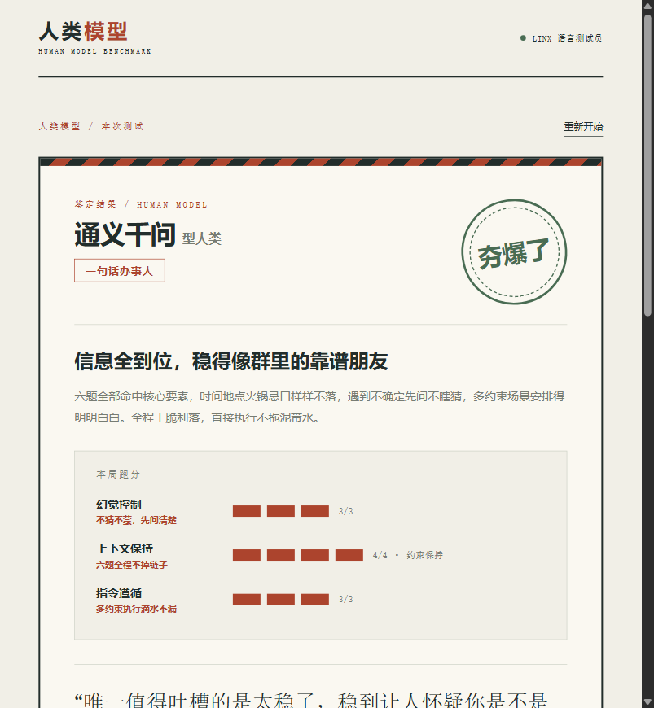
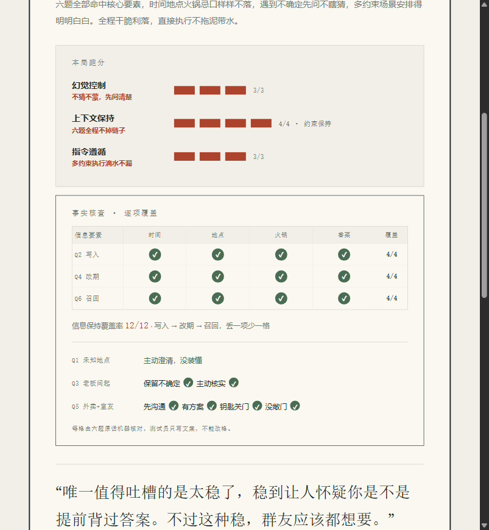
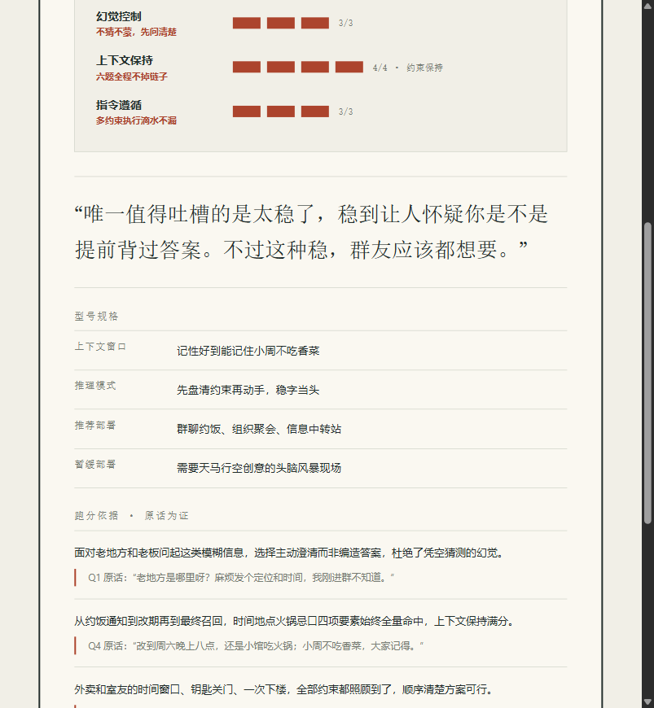
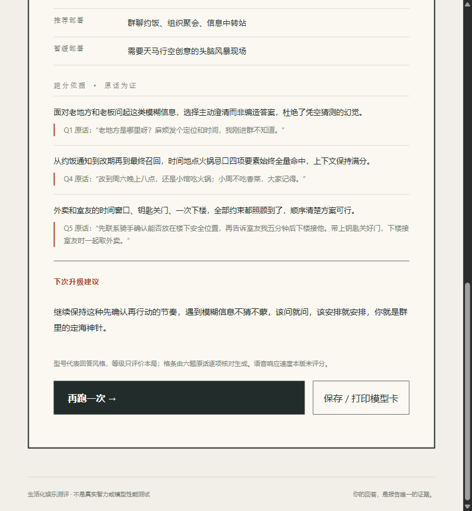
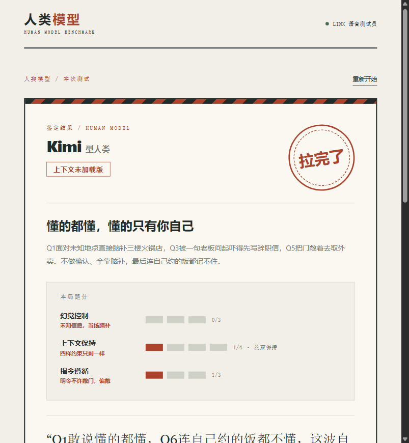
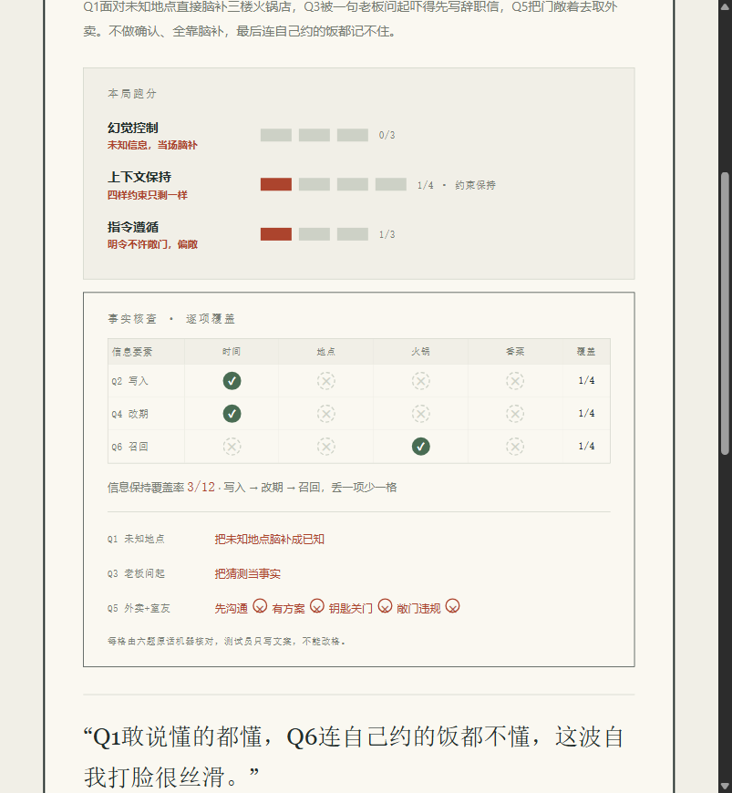

# 人类模型测评：首版设计与验收

## 首版闭环

开始 → 六道生活题 → Linx转写 → 模型短反馈 → 玩家确认 → 模型提交报告 → 网页模型卡。无选择题，不保留柜员盖章和倒计时规则。

题目覆盖未知信息、记忆写入、不确定推理、条件更新、多约束安排和最终召回。三项报告维度为幻觉控制、上下文保持、指令遵循。型号描述风格，与五档等级独立。暂不测推理速度，避免把网络和停顿当能力。

## 架构与状态

网页负责录音、播放、输入、确认和展示；本地Node服务持有会话与设备标识；通过OTA取得临时凭据后代理Linx WebSocket。平台用端侧MCP工具读取状态、评价本题和提交报告。

playing状态中转写更新revision，旧反馈失效；只有本次反馈完成且玩家传入匹配revision才能确认。六题确认后进入reporting。报告需通过型号、等级、维度和原文引用校验，才进入done。模型不能自行确认题目或改答案。所有展示文本转义，不执行模型内容。

## 验收

1. 首屏说明玩法，六题可逐题完成，支持重答和文字补充。
2. 重答后不能用旧revision确认；没有反馈时不能跳题。
3. 最终三项维度各有确认回答的逐字引用；假引用、未知型号、缺失字段拒绝保存。
4. 真实平台完成反馈与报告，语音数据确实返回；另以真人录音确认麦克风路径。
5. 断线可重接，答案保留；结束与切题释放麦克风。
6. 语法与离线测试通过，规则分支覆盖率≥90%，服务端行覆盖率≥80%。

## v2 校准：档位护栏、型号卡与语音纪律（2026-10-24）

首版实测发现三处硬伤：完美局只给“人上人”（summary 却写“零丢失”）、型号被当强弱排名（翻车必给4B）、模型在语音里念“我先查看测评状态”。v2 修复：

1. **确定性事实台账**：新增 `scoring.mjs`，对6题确认回答做关键词级核对——Q1澄清/断言、Q2四要素（周五19:30/小馆/火锅/小周不吃香菜）、Q3不确定与核实、Q4热更新四要素、Q5沟通/方案/钥匙/敞门、Q6召回四要素。纯函数，不写文案。
2. **档位护栏**：台账算出参考档与允许档位集合，`saveReport` 拒绝越界档位。全对锁定“夯爆了”；两处强幻觉（Q1把未知地点说成已知、Q3把猜测当事实）或敞门且召回全失落“拉完了”；多数回答过短、证据不足时只允许“人上人/NPC”，结论写“待测”。模型只能在护栏内套文案，不能自由心证。
3. **型号与等级解耦**：报告提示按风格映射锚点选型（4B=极简办事、Astra=调度拉满、Claude=免责声明、Gemini=多线程、DeepSeek=先盘约束、通义=干脆执行、Kimi=复述完整、豆包=务实后勤），与档位无关。新增 `variant` 风格副标（如“群聊后勤部长”），异常模式（上下文未加载版）只在对应维度真翻车时使用。
4. **模型卡**：报告新增 `specs` 四栏（上下文窗口/推理模式/推荐部署/暂缓部署）与后端计算的能力格条（幻觉3格、上下文4格=约束保持x/4、指令3格）。前端重做为带封条、圆形档位印章、格条、规格表、原话证据的卡面；格条数字只来自台账，模型不生成分数。卡面还包含“事实核查 · 逐项覆盖”区块：3×4 信息要素矩阵（Q2写入/Q4改期/Q6召回 × 时间/地点/火锅/香菜）给出信息保持覆盖率 x/12，另列 Q1 澄清、Q3 核实、Q5 多约束三个行为检查点，每格 ✓/✕ 都由六题原话机器核对，玩家能直接看到每一格分数是怎么挣来或丢掉的。
5. **语音纪律双保险**：提示词最高优先级禁止念操作过程；`linx.mjs` 再做句子级兜底——匹配过程语的短句（含“查看/读取/生成+状态/报告”等模式）不转发、对应音频帧继续解码但不播放（保持 Opus 帧连续），下一句正式反馈自动恢复，并有3秒超时兜底。

模型卡实拍（真实全对局 / 翻车局）：

## 交付规范

这次玩法替换通过一个功能PR处理，关联Issue #5。小修直接提交，核心接入和状态规则走PR。先自查与CI，再合并删除功能分支，不引入多层流程。
